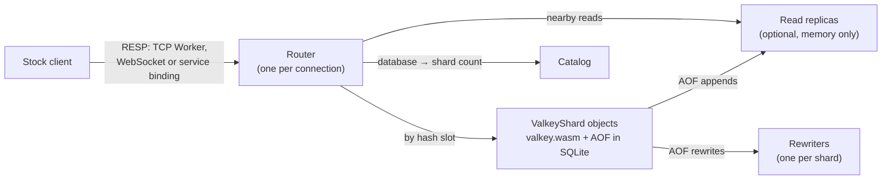

# vado

Valkey on Cloudflare Durable Objects. Each shard is a Durable Object running real Valkey 9.1, compiled to
WebAssembly, with its append-only file in the object's SQLite. A router in the Worker spreads keys over the shards by
hash slot, so stock clients (valkey-cli, ioredis, valkey-benchmark) see one ordinary Valkey server.

Experimental. Independent project, not an official Cloudflare or Valkey product.

## What it does

- Real Valkey 9.1 per shard, so replies and errors are Valkey's own, behind one address for stock clients.
- Acknowledged writes survive resets and deploys. Under load, many writes share one storage commit.
- AOF rewrites run in a separate rewriter object, so a shard keeps serving while Valkey compacts its log.
- A database's shards rotate over eight Durable Object classes, so its first eight shards never share an isolate's
  memory or thread.
- A database's shards can be spread over regions, and each shard can keep read replicas in other regions. Routers
  read from a replica in or next to their region, and a connection still reads its own writes.
- A local live view (`ui/`) shows each shard and replica, where traffic enters, and response times.

## How it works



A write is acknowledged only after its AOF entry is committed to SQLite, so acknowledged writes survive resets and
deploys. See [the architecture](docs/architecture.md) and [life of a command](docs/lifecycle.md).

## Quick start

Requires Node and `wrangler`.

```sh
npm install
scripts/local.sh fresh                  # workerd: TCP 127.0.0.1:6380, HTTP 127.0.0.1:8787
valkey-cli -p 6380 SET hello world
scripts/test-local.sh                   # the whole local suite
```

To deploy:

```sh
wrangler secret put VALKEY_PASSWORD
wrangler deploy
node scripts/ws-shim.mjs wss://<your-worker>.workers.dev/ws 6379
valkey-cli -p 6379 --user mydb --pass "$VALKEY_PASSWORD"     # AUTH <database> <password>
```

From another Worker, use a service binding and `env.VALKEY.connect("mydb:6379")`, or ioredis with
`bindingConnector` from `src/client.js`. For raw TCP, put a TCP Worker (Spectrum, Workers (tcp)) in front. Details:
[build, deploy and operate](docs/operations.md).

## Caveats

- One password for every database, and no ACLs. Set `VALKEY_PASSWORD` before exposing a TCP Worker, and turn on TLS.
  [Security](docs/security.md).
- 64 MB of data per shard, about 8 MB per request, and a database's shard count, regions and replicas are fixed
  when it is created. A shard's wasm memory never shrinks after deletes.
  [Shards and limits](docs/scaling.md).
- `CONFIG SET` takes only settings that change how data behaves; `SAVE`, `BGREWRITEAOF` and `ACL` are refused.
  [Security](docs/security.md#what-clients-can-change).
- A command in flight when its shard resets gets `ERR shard connection lost; the command may or may not have run`.
  Only read-only commands retry. [Durability and failures](docs/durability.md).
- Multi-key commands across slots, other than MGET, MSET, DEL, UNLINK, EXISTS and TOUCH, get `CROSSSLOT`, as in Valkey
  Cluster. Use `{hashtags}`, or a 1-shard database.
- A read from a replica can miss a write acknowledged on another connection, for up to one replication lag (the
  writer can `WAIT` for its replicas first). Each replica also costs its primary write throughput: about 50k SET/s
  per shard with 9 replicas, against about 130k with none. [Durability and failures](docs/durability.md#read-replicas).
- Latency is the client's hop to the Worker plus the Worker's hop to the shards, plus a storage commit for writes.
  Set `LOCATION_HINT` or a database's regions near your clients. [Measurements](docs/measurements.md).

## Docs

[Architecture](docs/architecture.md), [life of a command](docs/lifecycle.md), [durability and failures](docs/durability.md),
[shards and limits](docs/scaling.md), [security](docs/security.md), [build, deploy and operate](docs/operations.md) and
[measurements](docs/measurements.md). To run the live view, see [watch it live](docs/operations.md#watch-it-live).
Rules for changing the code: [AGENTS.md](AGENTS.md).

## License

[Apache-2.0](LICENSE). `vendor/valkey.wasm` is a build of Valkey and valkey-wasm, both BSD-3-Clause; see
[NOTICE](NOTICE) and [vendor/README.md](vendor/README.md).
