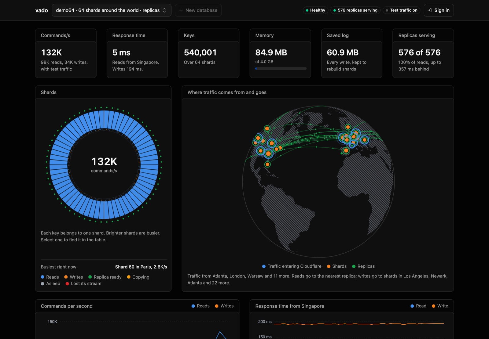
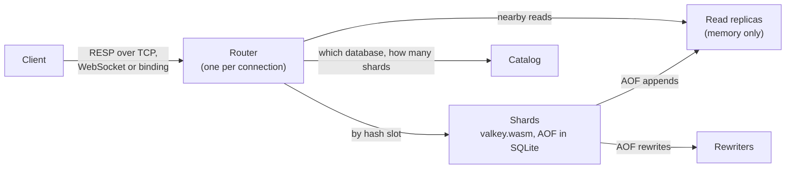

# vado

Valkey on Cloudflare Durable Objects.

Each shard is a Durable Object running real Valkey 9.1, compiled to WebAssembly, with its append-only file in the
object's SQLite. A router in the Worker spreads keys over the shards by hash slot, so `valkey-cli`, ioredis and
`valkey-benchmark` see one ordinary Valkey server.

Experimental. An independent project, not an official Cloudflare or Valkey product.



## What you get

- Real Valkey: commands, replies and errors are Valkey's own. Clients connect over TCP, a WebSocket or a service
  binding.
- Durable writes. A reply leaves only after its AOF entry is committed to SQLite, and under load many writes share
  one commit.
- Shards in the regions you pick, each with read replicas in other regions if you want them. Routers read from the
  nearest copy, a connection always reads its own writes, and `WAIT` counts the replicas that have them.
- AOF rewrites in a helper object, so a shard keeps serving while Valkey compacts its log.
- A password per database, and databases that can be dropped for good.
- A live dashboard at the Worker's URL: shards, replicas on a spinning globe, where traffic enters, response times
  and a timeline. Anyone can watch. Signing in lets you create databases, run commands, restart shards and send
  test traffic.

## How it works



Each client connection gets a router. It parses RESP, finds the hash slot of each key, and sends the command to
the shard that owns it, or to a nearby replica for a read that can go there. A shard runs Valkey with
`appendfsync always`. Its files live in SQLite, so the Durable Object's output gate holds each reply until the write
under it is stored. Replicas are sent the shard's AOF as a starting copy, then every append, and keep it all in
memory. More in [architecture](docs/architecture.md) and [life of a command](docs/lifecycle.md).

## Quick start

Requires Node and `wrangler`. Run it locally on `workerd`:

```sh
npm install
scripts/local.sh fresh                  # TCP 127.0.0.1:6380, HTTP 127.0.0.1:8787
valkey-cli -p 6380 SET hello world
scripts/test-local.sh                   # the local suite
```

Deploy it:

```sh
npm --prefix dashboard install
wrangler secret put VALKEY_PASSWORD
wrangler secret put BENCH_TOKEN         # optional: the bench API and dashboard sign-in
npm run deploy                          # this Worker, then the dashboard
```

On a new account the two Workers bind to each other, so the first deploy goes in three steps
([operations](docs/operations.md#watch-it-live)). Then connect a stock client:

```sh
node scripts/ws-shim.mjs wss://<your-worker>.workers.dev/ws 6379
valkey-cli -p 6379 --user mydb --pass "$VALKEY_PASSWORD"     # the username picks the database
```

For raw TCP, put a TCP Worker or Spectrum in front. From another Worker, use a service binding and
`env.VALKEY.connect("mydb:6379")`, or ioredis with `bindingConnector` from `src/client/ioredis.js`. Details in
[build, deploy and operate](docs/operations.md).

## Limits

- **Size.** 64 MB of data per shard and about 8 MB per request. A database's shard count, regions and replicas are
  fixed when it is created, and a shard's wasm memory never shrinks after deletes. See
  [shards and limits](docs/scaling.md).
- **Auth.** There is one shared password (`VALKEY_PASSWORD`), plus an optional password per database, and no ACLs.
  Set the password before exposing a TCP Worker, and use TLS. `CONFIG SET` takes only settings that change how data
  behaves; `SAVE`, `BGREWRITEAOF` and `ACL` are refused. See [security](docs/security.md).
- **Failures.** A command in flight when its shard resets gets `ERR shard connection lost; the command may or may
  not have run`. Only read-only commands retry. See [durability and failures](docs/durability.md).
- **Cluster rules.** Multi-key commands across slots get `CROSSSLOT`, as in Valkey Cluster, except MGET, MSET, DEL,
  UNLINK, EXISTS and TOUCH, which the router splits. Use `{hashtags}`, or a 1-shard database.
- **Replicas.** A read from a replica can miss another connection's write for up to one replication lag, unless the
  writer `WAIT`s. Each replica also costs its primary write throughput: about 50k SET/s per shard with 9 replicas,
  against about 130k with none. See [read replicas](docs/durability.md#read-replicas).
- **Latency.** It is the client's hop to the Worker, plus the Worker's hop to the shard, plus a storage commit for a
  write. Put shards near your clients with `LOCATION_HINT` or a database's regions. See
  [measurements](docs/measurements.md).

## Repository

| Path | What |
| --- | --- |
| [`src/`](src) | The Worker: router, shards, replication, catalog, the dashboard's backend, and the bench API |
| [`dashboard/`](dashboard) | The dashboard Worker (TanStack Start, React, Kumo) |
| [`wasm/`](wasm) | The Valkey build: patches, the WASI shim and the committed `valkey.wasm`, which CI rebuilds and checks |
| [`test/`](test) | Client-level tests: ioredis, RESP3, 1 vs N shards, `kill -9` durability and a concurrency hammer |
| [`scripts/`](scripts) | Local runs, the WebSocket-to-TCP shim and the colo table generator |
| [`docs/`](docs) | How it works, how to run it, and what it measured |

Rules for changing the code are in [AGENTS.md](AGENTS.md).

## Docs

- [Architecture](docs/architecture.md)
- [Life of a command](docs/lifecycle.md)
- [Durability and failures](docs/durability.md)
- [Shards, placement and limits](docs/scaling.md)
- [Security](docs/security.md)
- [Build, deploy and operate](docs/operations.md)
- [Measurements](docs/measurements.md)

## License

[Apache-2.0](LICENSE). `wasm/valkey.wasm` is a build of Valkey and valkey-wasm, both BSD-3-Clause; see
[NOTICE](NOTICE) and [wasm/](wasm/README.md).
