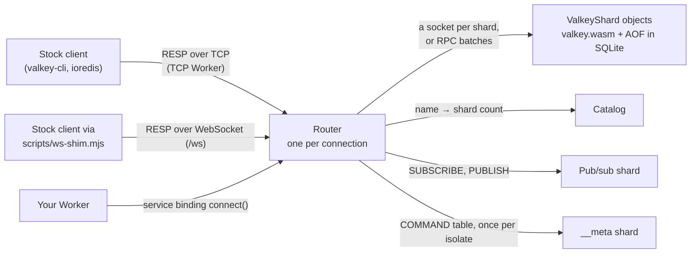

# Architecture

vado runs real Valkey, compiled to WebAssembly, inside Durable Objects. A database is a fixed number of shard
objects. A router in the Worker speaks RESP to the client and routes each command by hash slot, so the client
sees one ordinary Valkey server.

A box is a responsibility. The shard, pub/sub and `__meta` boxes are the same `ValkeyShard` class under different
names. An arrow is a call path, not a statement about which machine or data center runs it.

## Where everything lives

| Component | Where | Holds |
| --- | --- | --- |
| Worker (`src/index.js`) | Wherever the client's connection lands | Nothing durable. A `connect()` handler, `/ws`, and a token-protected bench API |
| Router (`src/router.js`) | In the Worker, one per client connection | Per-connection state: the database, AUTH, MULTI/WATCH, its upstreams |
| Shards (`ValkeyShard`, `SHARD` binding) | Durable Objects named `<db>.<created>.<i>` | One Valkey process each, owning a contiguous range of the 16,384 slots. Its AOF lives in the object's SQLite |
| Pub/sub shard | `ValkeyShard` named `<db>.<created>.pubsub` | Every channel of one database |
| `__meta` shard | `ValkeyShard` named `__meta` | Nothing. It answers `COMMAND`, which gives the router every command's key positions |
| Catalog (`Catalog`, `CATALOG` binding) | One Durable Object named `catalog` | Each database's name, creation time and shard count |

You don't run a server or a cluster manager. Cloudflare runs the objects; you still own the shard counts, the
password, and what happens to clients when a shard resets.

## Every service

### Router

- **Owns:** one client connection: parsing requests, AUTH, the selected database, MULTI/WATCH state, and an upstream
  per shard it has used.
- **Why needed:** clients expect one server. Valkey Cluster would need cluster-aware clients and `MOVED` redirects,
  and Durable Objects have no shared address space to redirect into.
- **How it helps:** single-slot commands pass through unchanged, pipelined on the shard's socket. Multi-key
  commands that are safe to split (MGET, MSET, DEL, UNLINK, EXISTS, TOUCH) are split by shard and merged in
  order. Whole-database commands (SCAN, KEYS, DBSIZE, FLUSHALL, INFO) go to every shard.
- **Trade-off:** one more hop than talking to a shard directly. Other multi-key commands across slots, and
  MULTI/WATCH/Lua over keys in different slots, get `CROSSSLOT`, as in Valkey Cluster.

### Shards

- **Owns:** a slot range of one database, in a real Valkey 9.1.1 process compiled to wasm, with its append-only file
  in the object's SQLite.
- **Why needed:** Valkey's semantics come from Valkey's code. Running it, rather than reimplementing commands,
  keeps every reply, error and edge case identical.
- **How it helps:** `appendfsync always` with a write-through filesystem means a reply leaves only after its write is
  stored. A reset object reloads its AOF and carries on.
- **Trade-off:** data lives in Valkey's memory, so a shard holds at most 64 MB inside the 128 MB isolate. wasm memory
  never shrinks. The wasm build carries a small patch (`vendor/valkey-wasm.patch`).

### Catalog

- **Owns:** the list of databases and their shard counts.
- **Why needed:** routing must be computed, not looked up per command, and a shard count must never change under
  existing keys.
- **How it helps:** a database is created on first use with the shard count of the `SHARD_EPOCHS` entry in force,
  or an explicit count. Each isolate caches the record, since it never changes.
- **Trade-off:** no online resharding. More capacity means a new database with more shards.

### Pub/sub shard

- **Owns:** all channels of one database, on one Valkey.
- **Why needed:** a PUBLISH must reach subscribers regardless of which shard their keys live on.
- **How it helps:** ordinary Valkey pub/sub semantics, including RESP3 pushes, on a dedicated object.
- **Trade-off:** one object per database caps pub/sub throughput. Messages aren't durable, as in Valkey.

### WebSocket ingress

- **Owns:** `/ws`, raw RESP over a WebSocket, for networks without a TCP Worker. `scripts/ws-shim.mjs` turns it back
  into a local TCP port.
- **Why needed:** a Worker's public URL takes HTTP, not raw TCP.
- **How it helps:** any stock client works through the shim, and the path is the same router.
- **Trade-off:** WebSockets can't push back on the sender, so a client that outruns its router by `WS_MAX_QUEUED` is
  disconnected. Served only when `VALKEY_PASSWORD` is set.

## What the design buys, and costs

| Choice | Benefit | Cost |
| --- | --- | --- |
| Real Valkey in wasm | Valkey's own behavior for every command it runs | 64 MB per shard, memory that never shrinks, a patch to maintain |
| AOF in SQLite, `appendfsync always` | Acknowledged writes survive resets and deploys | One billed row write per write; each write waits for its commit |
| A router per connection | Stock clients, no cluster support needed | An extra hop; cross-slot limits |
| Shard count fixed at creation | Routing is computed, with no directory to keep consistent | No online resharding |
| Sockets, with RPC batches past a budget | Sockets keep per-shard order for free | The RPC path needs explicit ordering and costs more CPU per batch |
| Backpressure on every hop | Memory stays bounded under any load | Overload slows clients down instead of failing them fast |

See [life of a command](lifecycle.md), [durability and failures](durability.md), [shards and limits](scaling.md),
[security](security.md), [operations](operations.md) and [measurements](measurements.md).
