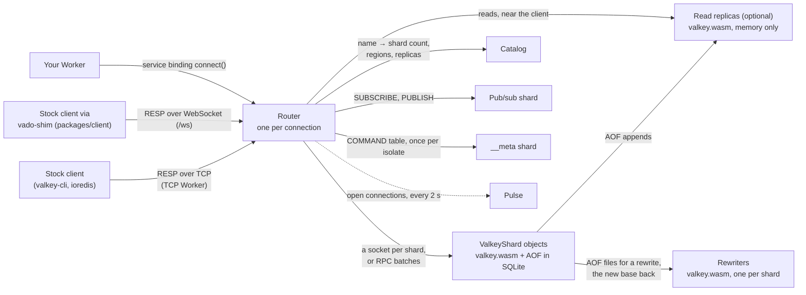

# Architecture

vado runs real Valkey, compiled to WebAssembly, inside Durable Objects. A database is a fixed number of shard
objects, optionally spread over regions, and each shard can keep read replicas in other regions. A database can run
Redis instead ([flavours](#flavours)); this page says Valkey for either. A router in the
Worker speaks RESP to the client and routes each command by hash slot, so the client sees one ordinary Valkey server.

A box is a responsibility. The shard, replica, pub/sub and `__meta` boxes run the same Durable Object code under
different object names. It is exported as eight classes, `ValkeyShard` and `ValkeyShard1` to `ValkeyShard7`, so a
database's shards can be spread over them. The rewriters are a class of their own, exported the same way. An arrow
is a call path, not a statement about which machine or data center runs it.

## Where everything lives

| Component | Where | Holds |
| --- | --- | --- |
| Worker (`src/server.ts`, `packages/server/src/index.js`) | Wherever the client's connection lands | Nothing durable. A `connect()` handler, `/ws`, `/live` and a token-protected bench API. Other requests go to the dashboard |
| Router (`packages/server/src/router/router.js`) | In the Worker, one per client connection | Per-connection state: the database, AUTH, MULTI/WATCH, recent writes per shard, its upstreams |
| Shards (`ValkeyShard` to `ValkeyShard7`, bindings `SHARD` to `SHARD7`) | Durable Objects named `<db>.<created>.<i>`, in class `i % 8`, placed by the database's `regions` or `LOCATION_HINT` | One Valkey process each, owning a contiguous range of the 16,384 slots. Its AOF lives in the object's SQLite |
| Read replicas (`packages/server/src/replication/replication.js`) | Class `8 + k` for a primary of class `k` (`ValkeyShard8` to `ValkeyShard15`), named `<db>.<created>.<i>.r.<region>`, one per shard per replica region | A copy of one shard's data, in memory only, kept current from the shard's AOF |
| Rewriters (`packages/server/src/shard/rewriter.js`, `ValkeyRewriter` to `ValkeyRewriter7`, bindings `REWRITER` to `REWRITER7`) | Durable Objects named like their shard, in the rewriter class with the shard's class number | During a rewrite, a copy of the shard's AOF files and the new base. Nothing after it |
| Pub/sub shard | `ValkeyShard` named `<db>.<created>.pubsub` | Every channel of one database |
| `__meta` shard | `ValkeyShard` named `__meta` | Nothing. It answers `COMMAND`, which gives the router every command's key positions |
| Catalog (`Catalog`, `CATALOG` binding) | One Durable Object named `catalog` | Each database's name, creation time, shard count, its `regions` and `replicas` lists, and how many shard classes its shards rotate over |
| Pulse (`packages/server/src/admin/pulse.js`, `PULSE` binding) | One Durable Object named `pulse` | In memory only: each isolate's latest report of its open connections |
| Senders (`packages/server/src/bench/sender.js`, `SENDER` binding) | Durable Objects named `<region>` or `<region>/<k>`, placed in that region | Only while the dashboard's test traffic runs: its database and deadline, one round per alarm. They run bench tests, so test traffic starts in a chosen region |
| Watchers (`packages/server/src/admin/watcher.js`, `WATCHER` binding) | One Durable Object per database being watched, named after it, placed near its first viewer | In memory only: five minutes of history, recent events, and two probe connections. Polls the database's shards and ready replicas once a second while anyone has `/live` open, and stops when nobody does |
| Dashboard (`src/`) | In the same Worker, loaded on the first page request | Nothing. A TanStack Start app: pages, and server functions that call `Admin` in-process after checking Cloudflare Access |

You don't run a server or a cluster manager. Cloudflare runs the objects; you still own the shard counts, the
placement, the password, and what happens to clients when a shard resets.

## Every service

### Router

- **Owns:** one client connection: parsing requests, AUTH, the selected database, MULTI/WATCH state, and an upstream
  per shard (and replica) it has used.
- **Why needed:** clients expect one server. Valkey Cluster would need cluster-aware clients and `MOVED` redirects,
  and Durable Objects have no shared address space to redirect into.
- **How it helps:** single-slot commands pass through unchanged, pipelined on the shard's socket. Multi-key
  commands that are safe to split (MGET, MSET, DEL, UNLINK, EXISTS, TOUCH) are split by shard and merged in
  order. Whole-database commands (SCAN, KEYS, DBSIZE, FLUSHALL, INFO) go to every shard. On a database with
  replicas, single-slot reads go to a nearby replica unless the connection needs the primary
  ([life of a command](lifecycle.md#reads-on-a-database-with-replicas)).
- **Trade-off:** one more hop than talking to a shard directly. Other multi-key commands across slots, and
  MULTI/WATCH/Lua over keys in different slots, get `CROSSSLOT`, as in Valkey Cluster.

### Shards

- **Owns:** a slot range of one database, in a real Valkey 9.1.1 process compiled to wasm, with its append-only file
  in the object's SQLite.
- **Why needed:** Valkey's semantics come from Valkey's code. Running it, rather than reimplementing commands,
  keeps every reply, error and edge case identical.
- **How it helps:** `appendfsync always` with a write-through filesystem means a reply leaves only after its write is
  stored. Input that arrives while a commit is in flight runs in the next pass and shares the next commit (group
  commit), so a busy shard writes far fewer rows. A reset object reloads its AOF and carries on.
- **Trade-off:** data lives in Valkey's memory, so a shard holds at most 64 MB inside the 128 MB isolate. wasm memory
  never shrinks. Objects of one class on one machine can share an isolate, and with it the isolate's memory limit and
  thread, so shard `i` of a database uses class `i % 8` ([shard classes](scaling.md#shard-classes-and-isolates)).
  With no `fork()` in wasm, a rewriter compacts the AOF in place of a forked child; without one, a rewrite runs
  inline and blocks the shard. The wasm build carries a few small patches (`packages/wasm/valkey/patches/`).

### Read replicas

- **Owns:** a copy of one shard in one region, in Valkey's memory (`appendonly no`).
- **Why needed:** a shard lives in one place, so a client far from it pays that distance on every read, and every
  reply from a primary also waits for its storage commits.
- **How it helps:** Valkey's AOF already holds every write as the commands that redo it. So the primary sends a
  replica its AOF files as a starting copy, then every append after it, over one socket per replica. Routers read
  from the replica in their own region, or a neighbouring one. A replica has no storage writes to wait for, so its
  reads stay fast while the primary is busy with writes or a rewrite.
- **Trade-off:** a read on another connection can be up to one replication lag old. Each replica's stream holds back
  the primary's input: one shard with 9 replicas took 49-61k SET/s, against about 130k with none. A primary with
  replicas measures them every 2 s while it's in use, and after 10 minutes with no activity anywhere it retires them
  and sleeps. Details in
  [durability and failures](durability.md#read-replicas).

### Rewriters

- **Owns:** one AOF rewrite at a time for one shard, in a Valkey of its own.
- **Why needed:** Valkey compacts its AOF by forking a child that writes a new base while the parent keeps serving.
  wasm has no `fork()`, so a rewrite inside the shard blocks it: 1.4-1.9 s for a 35.6 MB RDB base.
- **How it helps:** Valkey offers each rewrite to the host (`packages/wasm/valkey/patches/0004-host-aof-rewrite.patch`). The shard
  sends its rewriter the AOF files from before the incr file Valkey just opened. The rewriter loads them, rewrites
  inline, blocking only itself, and sends back the new base. The shard writes it to Valkey's temp file while it
  keeps serving, and Valkey swaps it in as if a forked child had finished. Shard class `k` uses rewriter class `k`,
  so a database's shards rewriting at once don't share a rewriter isolate.
- **Trade-off:** a rewrite takes longer end to end (5.2-5.9 s for that base) and moves the files to another object
  and the base back. After a rewriter fails, the shard rewrites inline for 10 minutes. Details in
  [durability and failures](durability.md#aof-rewrites).

### Catalog

- **Owns:** the list of databases, their shard counts and their placement.
- **Why needed:** routing must be computed, not looked up per command, and a shard count must never change under
  existing keys.
- **How it helps:** a database is created on first use with the shard count of the `SHARD_EPOCHS` entry in force,
  or an explicit count, and optionally the regions to spread its shards over and the regions to keep replicas in.
  Each isolate caches the record, since it never changes.
- **Trade-off:** no online resharding, and no moving a database. More capacity, or a different placement, means a
  new database.

### Flavours

A database's flavour, `valkey` or `redis`, is fixed when it is created and kept in the catalog (`flavour`; empty
means Valkey, so older databases need nothing). A Redis database's object names carry a `redis` segment
(`<name>.<created>.redis.<i>`, its pub/sub shard and its replicas likewise), so every object knows which wasm to
boot from its own name, with no catalog lookup. Its rewriters are named after its shards, and Redis's COMMAND table
comes from a `__meta.redis` object. The two builds have the same exports and almost the same imports, and Redis
gets Valkey's `import-mode` from a patch, so the host, router and replication code is the same for both. A
connection can switch between a Valkey and a Redis database with AUTH; the router takes the new database's command
table with it.

### Pub/sub shard

- **Owns:** all channels of one database, on one Valkey.
- **Why needed:** a PUBLISH must reach subscribers regardless of which shard their keys live on.
- **How it helps:** ordinary Valkey pub/sub semantics, including RESP3 pushes, on a dedicated object.
- **Trade-off:** one object per database caps pub/sub throughput. Messages aren't durable, as in Valkey. It has no
  replicas and stays at `LOCATION_HINT`.

### Pulse

- **Owns:** a picture of open connections right now. Every isolate running routers reports its connections
  (database, how each arrived, commands so far) every 2 s (`PULSE_MS`), from each connection's own timer.
- **Why needed:** routers run in many isolates in many places and share nothing, so nothing else knows where
  traffic enters.
- **How it helps:** the bench `pulse` endpoint, and the dashboard's globe, show connections and commands per
  second by location.
- **Trade-off:** in memory only, so a reset loses one report interval. An isolate silent for 10 s drops out. Reports
  are sent only when a `PULSE` binding exists.

### WebSocket ingress

- **Owns:** `/ws`, raw RESP over a WebSocket, for networks without a TCP Worker. `vado-shim (packages/client)` turns it back
  into a local TCP port.
- **Why needed:** a Worker's public URL takes HTTP, not raw TCP.
- **How it helps:** any stock client works through the shim, and the path is the same router.
- **Trade-off:** WebSockets can't push back on the sender, so a client that outruns its router by `WS_MAX_QUEUED` is
  disconnected. Nor can a Worker see what its client has read: on the `vado-acks` subprotocol, which the shim speaks,
  the client says how many bytes it has taken, and the router stops sending past 8 MB unacknowledged
  (`WS_UNACKED`). Other WebSocket clients get replies as fast as they're made. Served only when `VALKEY_PASSWORD`
  is set.

## What the design buys, and costs

| Choice | Benefit | Cost |
| --- | --- | --- |
| Real Valkey in wasm | Valkey's own behavior for every command it runs | 64 MB per shard, memory that never shrinks, a patch to maintain |
| AOF in SQLite, `appendfsync always` | Acknowledged writes survive resets and deploys | Each write waits for a storage commit. Rows written are billed: one per unpipelined write, far fewer under load |
| Group commit, two commits in flight | Under load one commit carries many writes, so more writes per second and fewer rows | Input that arrives during two commits waits for one of them |
| AOF rewrites in a rewriter object | The shard keeps serving during a rewrite: PING p99 128-175 ms, against 1.4-1.9 s blocked inline for a 35.6 MB base | Each rewrite copies the files to another object and the base back. After a rewriter fails, rewrites run inline, blocking, for 10 minutes |
| Read replicas fed by the AOF | Reads near the client that don't wait for commits | Reads across connections can be stale; fewer writes per shard; an idle database's replicas are retired and copied again on its next use |
| A router per connection | Stock clients, no cluster support needed | An extra hop; cross-slot limits |
| Shards spread over eight classes | A database's first eight shards never share an isolate's memory or thread | Eight bindings and migrations to keep; shards `i` and `i + 8`, or of different databases, can still share |
| Shard count and placement fixed at creation | Routing is computed, with no directory to keep consistent | No online resharding or moving |
| Sockets, with RPC batches past a budget | Sockets keep per-shard order for free | The RPC path needs explicit ordering and costs more CPU per batch |
| Backpressure on every hop | Memory stays bounded under any load | Overload slows clients down instead of failing them fast |

See [life of a command](lifecycle.md), [durability and failures](durability.md), [shards and limits](scaling.md),
[security](security.md), [operations](operations.md) and [measurements](measurements.md).
